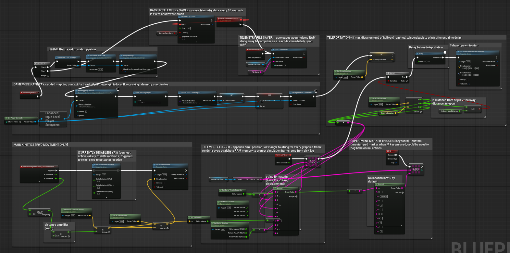

# UE 5.7 Virtual Reality Linear Track with Telemetry Data Pipeline
A closed-loop, custom-scripted virtual reality (VR) linear track that logs real-time telemetry data, built in Unreal Engine (UE) 5.7.. Designed for rodent navigational and behavioural experiments with limited electromagnetic interference and low-latency data processing for use with electrophysiology. 

## Table of Contents
1. [System Pipeline Demo](#system-pipeline-demo)
2. [Background & Objective](#background-&-objective)
3. [Core VR Environment Features](#core-VR-environment-features)
4. [Blueprint Architecture](#blueprint-architecture)
5. [Telemetry Data Pipeline](#telemetry-data-pipeline)
6. [Applications & Impact](#applications-&-impact)
7. [Limitations](#limitations)
8. [Future Directions](#future-directions)

## System Pipeline
### Computer Mouse Sensor &rarr; Unreal Engine &rarr; Telemetry Output
An optical motion sensor of a Logitech wireless computer mouse tracks movement from a rodent treadmill. The movement is fed into the UE environment, which updates the position accordingly. Upon program exit, a .sav file is generated with the corresponding telemetry output. The file is converted to a readable .csv file through a Python processing script. 

https://github.com/user-attachments/assets/a29de731-eb81-4aad-a683-b99e8f6e168a

**Note that the sensor was moved manually across a surface for the demo above. To see real-time use with a treadmill and the physical setup, see demos [here](demo).**

## Background & Objective
To investigate underlying neuronal circuitry in Alzheimer's Disease, the Zwang Lab records electrophysiology of mice with mesh electronics as they navigate a linear track in VR. 

The prior setup faced two primary bottlenecks: 

1. **Platform Modification**: Running the VR system on MATLAB required extensive, low-level coding to make even small modifications
2. **Electromagnetic Interference (EMI)**: The laser motion sensor introduced significant EMI into data recordings, making it difficult to isolate single-unit neuronal activity

The redesigned pipeline addresses these challenges through:
1. **Unreal Engine**: Built the VR environment in Unreal Engine using blueprint scripting, providing a simplified, readable, and visual development platform for rapid configuration and deployment
2. **Optical Motion Tracking**: Uses an optical motion sensor to reduce EMI

This pipeline improves the precision of the data collected and improves downstream data analysis, providing a strong framework to facilitate future clinical translation.

## Core VR Environment Features
- continuous saving/backup saver
- variable to save custom file name
- experimental keyboard marker
- teleportation looping w/ 3 second delay
- restricted location - fwd (y-axis) movement only, but yaw/pitch/roll all possible w/ scripting
- 5 distinct visual patterns using materials in UE for mouse memory/positional learning and memory encoding
## Blueprint Architecture
Isolated photos of the game mode, kinetics, and teleportation scripting sections are included under blueprints [here](assets/blueprints).

## Telemetry Data Pipeline
- name file with variable in UE 
- set frame rate for save data intervals
- find sav in SavedGames folder
- code to convert sav to csv and directly save to given folder path 
- table output: Timestep_sec; player_X, Player_Y, player_Z, Player Yaw; Displacement
## Applications & Impact
- lowered EMI from system = lower RMS for ephys, greater spike detection precison, easier for downstream data processing/analysis
- future clinical translation - UE has built in and external tools to easily pair with headsets like Meta Quest
## Limitations
- limited to UE 5.7 at the moment, have not tried compiling or running on newer/older versions; with this, serialCOM plugin does not work for hardware incorporation like w/ a microcontroller (arduino) - actively troubleshooting
## Future Directions
- future clinical translation
- integrating serialCOM plugin for UE 5.7 to add aspects like lick sensor to enable more experiments; place cell encoding
